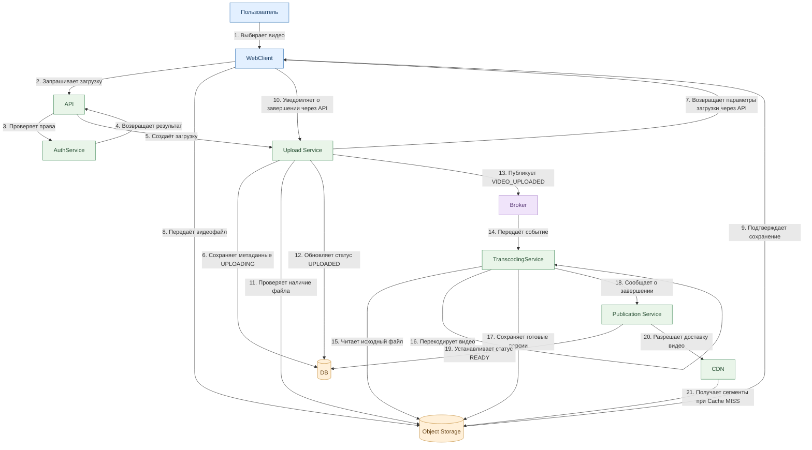

# Сценарий 1. Пользователь загружает видео в YouTube

## 1. Порядок взаимодействия
1. **Пользователь** — в WebClient выбирает видеофайл и инициирует загрузку
2. **WebClient** — отправляет в API запрос на загрузку видео
3. **API** — обращается к AuthService для проверки прав пользователя
4. **AuthService** — проверяет права пользователя и возвращает результат в API
5. **API** — перенаправляет запрос на создание загрузки в Upload Service
6. **Upload Service** — сохраняет метаданные видео в DB
7. **WebClient** — передаёт видеофайл в Object Storage
8. **Object Storage** — сохраняет видеофайл
9. **WebClient** — уведомляет Upload Service через API о завершении загрузки
10. **Upload Service** — проверяет наличие загруженного файла в Object Storage
11. **Upload Service** — отправляет в Broker событие что загружен файл и нужно его обработать
12. **Broker** — передаёт событие в TranscodingService
14. **TranscodingService** — получает видеофайл из Object Storage, перекодирует видео в несколько разрешений и форматов, сохраняет обработанные версии видео в Object Storage.
15. **TranscodingService** — уведомляет Publication Service о завершении обработки видео
16. **Publication Service** — обновляет статус видео в DB на READY
17. **CDN** — при первом запросе получает необходимые видеосегменты из Object Storage и кэширует их для последующих просмотров. Затем держит в кеше

## 2. Схема

## 3. Архитектурные решения

| Компонент | Ответственность |
|---|---|
| WebClient | Пользовательский интерфейс |
| API | Приём и маршрутизация запросов |
| AuthService | Аутентификация и авторизация |
| Upload Service | Управление загрузкой видео |
| Object Storage | Хранение исходных и обработанных видео |
| DB | Хранение метаданных и статусов видео |
| Broker | Асинхронная доставка событий |
| TranscodingService | Перекодирование видео |
| Publication Service | Управление публикацией |
| CDN | Кэширование и доставка видео |

### Ключевые принципы

1. Видеофайл загружается напрямую в Object Storage, минуя API.
2. Upload Service управляет загрузкой, но не передаёт через себя весь видеофайл.
3. Перекодирование выполняется асинхронно через Broker.
4. Исходные и обработанные видео хранятся отдельно от метаданных.
5. CDN обеспечивает доставку готового видео зрителям.
